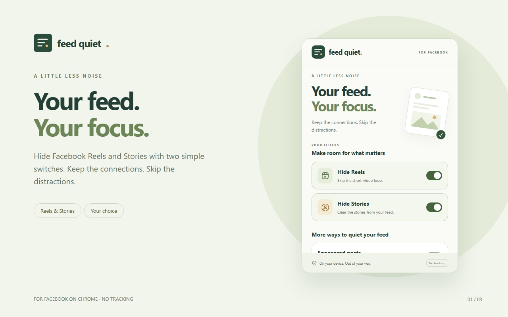
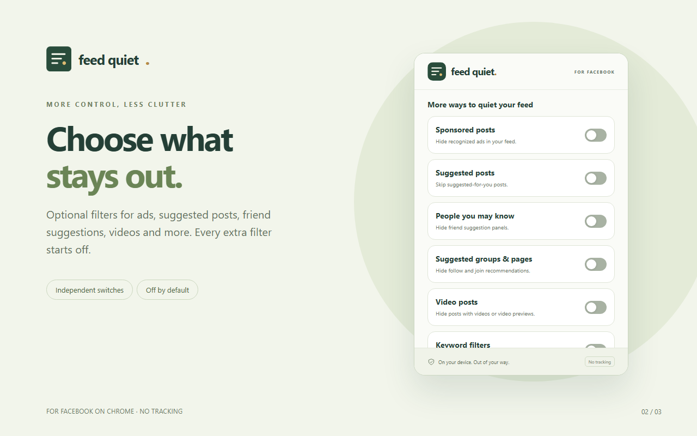
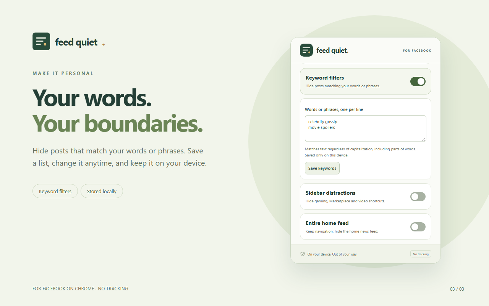
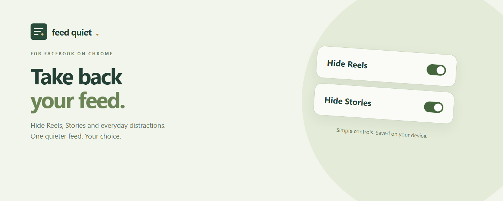

# Feed Quiet for Facebook


A Chrome extension with independent switches for a quieter feed. **Hide Reels** and **Hide Stories** remain first and keep their existing settings (on for a fresh installation). All additional filters and Pause filtering default to **off**. Preferences are saved on the device and changes apply to open Facebook tabs.

**Chrome Web Store:** Submitted for review. You can install the extension locally while review is pending.

## Screenshots

### Reels and Stories



### Optional filters



### Keyword filtering



### Additional filters

Below Reels and Stories, scroll to find sponsored posts, suggested posts, people you may know, suggested groups/pages, video posts, keyword filters, sidebar distractions, and the entire home feed. Each is optional and independent. Home-feed hiding applies only on the home page; it preserves navigation and group/profile feeds. Sidebar filtering hides recognized Marketplace, gaming, and video shortcuts.

Keyword matching uses literal, case-insensitive words or phrases, one per line (up to 2,000 characters). Click **Save keywords** after editing. Matching includes parts of words. Identifiable comment containers are excluded; on unknown layouts the fallback may match other post text.

**Pause filtering** restores hidden content until turned off and keeps your choices. **Hide distractions** enables Reels, Stories, ads, suggestions, people, group/page recommendations, and sidebar filters. **Minimal Facebook** also hides the home feed. Presets only apply when you click **Apply**; neither enables keyword or video filtering. **Restore defaults** resets Reels/Stories to on, everything else to off, and clears saved keywords.

After updating, reload the extension at `chrome://extensions` and refresh Facebook tabs once. New settings migrate automatically without changing existing Reels/Stories choices.

## Install locally

1. Open `chrome://extensions` in Chrome.
2. Turn on **Developer mode** (top right).
3. Click **Load unpacked** and select the `extension` folder inside your downloaded or cloned copy of this project.
4. Refresh any Facebook tabs already open.
5. Pin **Feed Quiet for Facebook** from Chrome's Extensions menu, then click it to choose what to hide.

No build or npm installation is needed to use the extension. If using the ZIP in `dist`, extract it first and load the extracted folder containing `manifest.json`.

## Behavior and scope

- Hides recognized Reels and Stories shelves, media Reel posts, cards, and navigation links.
- Rechecks new content while scrolling and navigating within Facebook.
- Restores hidden elements when their filter is turned off, without reloading.
- Pauses videos inside hidden elements and intercepts subsequent playback.
- Runs on `facebook.com`, `www.facebook.com`, and `m.facebook.com` over HTTPS.
- Preserves ordinary post permalinks (`story.php`), which are unrelated to ephemeral Stories.
- Uses Facebook URLs, semantic headings, accessible labels, and selected `data-pagelet` values. English, Hebrew, and Arabic feature labels are included; URL detection is language independent.

This is visual filtering, not a network blocker or a parental-control tool. Facebook may still download hidden content, and direct Reels/Stories URLs are not blocked. Unknown layouts, unlabeled players, and some embedded/shared media may escape detection. Facebook changes its markup regularly, so the rules may need maintenance. There can be a brief flash before newly inserted content is hidden.

## Privacy

The extension requests only the `storage` permission plus content-script access to the three Facebook hosts above. It stores filter preferences, pause state, and user-entered keywords in `chrome.storage.local`. It makes no network requests, collects no analytics, and sends no feed data anywhere. It does not request access to cookies, browsing history, or other websites. See [PRIVACY.md](PRIVACY.md).

## Development

Requires Node.js 22 or newer for development checks.

```sh
npm ci
npm test
npm run package
```

Runtime code has no third-party dependencies. `jsdom` is a development-only dependency for DOM and popup integration tests. Packaging creates `dist/feed-quiet-1.1.0.zip` with only installable extension files.

Additional filters are best-effort: ads with obfuscated labels, unrecognized translations, suggestion panels without semantic containers, and unfamiliar video layouts may be missed. Automated fixtures cover each filter; live authenticated Facebook verification is still required.

| File | Purpose |
| --- | --- |
| `extension/manifest.json` | Manifest V3 configuration and site scope |
| `extension/rules.js` | Preferences and DOM detection rules |
| `extension/content.js` | Mutation observation, hiding/restoring, media pausing |
| `extension/popup.*` | Accessible filter switches, keyword configuration, and presets |
| `tests/extension.test.cjs` | Detection, lifecycle, storage, and popup tests |

The implementation follows Chrome's [content script documentation](https://developer.chrome.com/docs/extensions/develop/concepts/content-scripts) and [storage API](https://developer.chrome.com/docs/extensions/reference/api/storage).

## Store graphics

The finished assets are available in [store-assets](store-assets). Screenshots and promo tiles are 24-bit RGB PNGs without transparency.

| Asset | Dimensions | File |
| --- | --- | --- |
| Store icon | 128 × 128 | [PNG](store-assets/store-icon-128.png) |
| Reels and Stories screenshot | 1280 × 800 | [PNG](store-assets/01-screenshot.png) |
| Additional filters screenshot | 1280 × 800 | [PNG](store-assets/02-screenshot.png) |
| Keyword filtering screenshot | 1280 × 800 | [PNG](store-assets/03-screenshot.png) |
| Small promo tile | 440 × 280 | [PNG](store-assets/small-promo-440x280.png) |
| Marquee promo tile | 1400 × 560 | [PNG](store-assets/marquee-1400x560.png) |



To regenerate graphics on Windows with Google Chrome installed at its default location, run after `npm ci`:

```powershell
node scripts/store-assets.cjs
powershell -NoProfile -ExecutionPolicy Bypass -File scripts/render-store-assets.ps1
```

Screenshots show the actual popup UI rendered with example settings. Generated HTML previews and intermediate images are excluded from Git.

## Manual acceptance checks

Automated tests use representative fixtures, not a live authenticated Facebook feed. Before distributing, test with a signed-in account:

1. Check all four switch combinations on the home feed and verify ordinary posts remain visible.
2. Scroll to load more posts and navigate between home, a profile, and a group.
3. Switch both filters off and confirm the content returns. Paused videos may need to be restarted manually.
4. Reload Facebook and restart Chrome to verify preferences persist.
5. Test a second Facebook tab, keyboard navigation in the popup, and relevant interface languages.
6. Confirm hidden Reels do not continue playing audio. Report missed content with a sanitized DOM snippet so detection can be updated without private feed data.

This project is ready to load locally and has been submitted to the Chrome Web Store for review. Approval is pending. It has not been validated against a live signed-in Facebook feed. This is an independent project, unaffiliated with Meta or Facebook.
